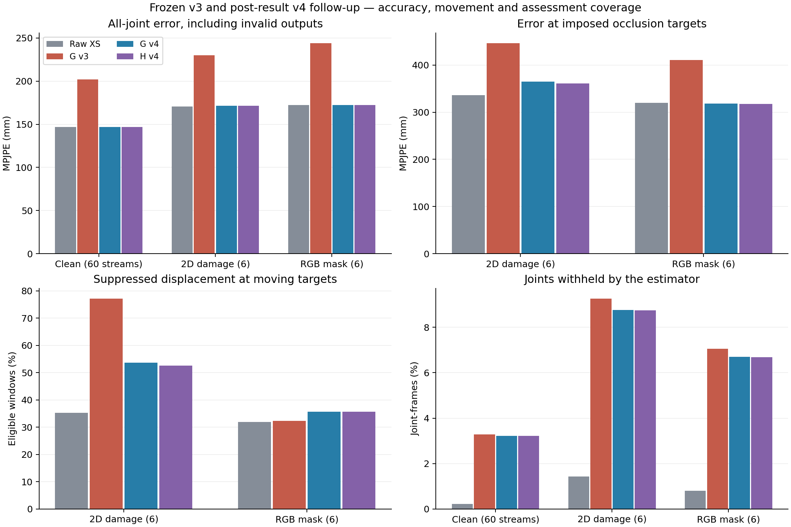

# 운동별 가림·동작·접촉 보정 실험

2026-10-21. **v3·v4 G/H 모두 기본 활성화를 권하지 않는다.** 관측된 관절을 그대로 보존하는 동작은 확인했지만, v3는 불확실한 관절을 오래 외삽하면서 원본보다 3D 오차가 커졌다. 원본 XS와 실험 기능 기본 OFF를 유지한다. v4는 이 실패 뒤에 만든 **예측 중단·원본 복귀 후속 검증**이며, 일반 영상 정확도는 원본과 사실상 같고 가림 중 움직임 억제·판정 보류 문제는 남았다.

v1과 v3의 clean 96개 및 실제 키포인트 손상/RGB 가림 각 6개 스트림을 모두 실행했다. v3 전체 평가·집계는 10월 21일 00:22:31 KST 완료했다. v4도 동일 입력의 G/H 온라인·SMPL 네 방법, 총432개 결과를 완료했다. 폭주는 줄었지만 원본 대비 정확도 향상이나 제품 채택은 입증하지 못했다. 모델 학습·가중치·채택 기준·임계값 탐색은 이 실험에 포함하지 않았다.

## 평가 대상과 자료 경계

| 항목 | 고정한 범위 |
| --- | --- |
| 입력 | 원본 pretrained MotionAGFormer-XS + RTMPose Halpe26 실험 A, L5 출력 |
| 운동·카메라 | squat, pushup, barbell_row × 4개 고정 카메라 |
| 설계용 / 별도 검증 | s03/s04/s05 36개 / s07/s08/s09/s10/s11 60개 스트림 |
| clean 점수 분모 | 설계용 337,552 / 검증용 568,004 관절·프레임, 골반 포함 17관절 |
| 실제 손상 | s07의 3운동 × 카메라 50591643/65906101, 조건별 6개 |
| 손상 점수 분모 | 조건·방법별 1,080 프레임 × 17관절 = 18,360 관절·프레임 |
| 사용 가능한 첫 출력 / 점수 시작 | t21 / t90; 모든 방법 동일한 L5 시점 |
| 온라인 체형 추정 | t21…80의 관측 60개, 뼈마다 신뢰 관측 최소 30개; t81 적용 |
| 추가 미래 프레임 | 0; 기존 L5 자체의 지연은 그대로 |

A 원본, B EMA smoothing, C 등속 예측, D Kalman, E D+약한 뼈 길이 제약, F 운동별 접촉·관계, G 적응형 신뢰도를 이용한 D+E+F, H G+인과적 방향전환 증거, HOLD 마지막 관측 유지다. E/G/H는 온라인 체형과 RGB-SMPL 체형을 구분하여 **12방법**이다. [실험 프로토콜](../experiments/motion_contact_protocol.md)과 [수학·API 계약](../experiments/motion_contact_contract.md)에 고정값과 입력 경계를 기록했다.

원본 XS의 골반 좌표가 항상 0은 아니므로 `(raw − current_root) × crop.side / (2 × imageHeight)`를 추정기에 넣고 역변환한다. 원본 배열은 별도로 보존했다. GT 자세·골반 깊이·중력·반복 구간은 출력 생성 뒤 **점수 계산에만** 사용한다. 따라서 표의 mm 단위 변환은 점수용 GT 깊이를 사용한 비교이며, 앱이 사람의 실제 깊이를 알고 있다는 뜻이 아니다. GT를 입력, anchor, phase, 목표 뼈 길이, 가림 위치에 넣지 않았다.

실제 RGB-SMPL은 SAM3DB→MHR→SMPL 예측 프로필이다. 알려진 카메라 내부 파라미터/왜곡은 사용했지만 GT 뼈 길이, 외부 파라미터, mocap, 공식 SMPL beta는 사용하지 않았다. 다만 평가 시퀀스 사진을 포함한 여러 사진의 집계이며 사진별 beta가 남아 있지 않아 독립 사진 cross-fit을 할 수 없다. `uses_evaluation_sequence=true`, 신뢰도 .7의 **사전 캘리브레이션 가정에 따른 부차 비교**다. 주 비교는 초기 관측만 사용하는 온라인 길이(.4)다. 초기 자세를 올바른 운동 자세로 지정하지 않았다.

## v3 전체 비교

검증용 60개 스트림. MPJPE는 골반 기준 위치 오차, PA는 similarity 정렬 후 부차 지표다. 보류된 관절도 전체 오차에 포함한다. 단위는 위치 mm, 보류율 %다.

| 방법 | 전체 MPJPE | PA-MPJPE | 손목 | 발목 | 평가 보류율 | 설계용36 MPJPE |
| --- | ---: | ---: | ---: | ---: | ---: | ---: |
| A 원본 | 146.839 | 89.501 | 180.158 | 258.069 | 0.226 | 151.639 |
| B smoothing | 146.683 | 89.757 | 179.573 | 258.366 | 2.844 | 151.436 |
| C 등속 | 146.954 | 89.807 | 180.382 | 258.362 | 0.960 | 151.832 |
| D Kalman | 148.209 | 91.244 | 183.580 | 259.971 | 3.418 | 152.928 |
| E-online | 148.195 | 91.217 | 183.468 | 259.971 | 3.521 | 152.909 |
| E-SMPL | 148.198 | 91.209 | 183.424 | 259.970 | 3.611 | 152.892 |
| F 접촉·관계 | 146.837 | 89.504 | 180.146 | 258.062 | 0.281 | 151.637 |
| G-online | 202.031 | 134.074 | 258.633 | 267.981 | 3.278 | 239.559 |
| G-SMPL | 202.028 | 134.061 | 258.609 | 267.981 | 3.323 | 239.547 |
| H-online | 202.014 | 134.056 | 258.480 | 267.981 | 3.274 | 239.555 |
| H-SMPL | 202.011 | 134.044 | 258.455 | 267.981 | 3.317 | 239.542 |
| HOLD | 146.973 | 89.833 | 180.750 | 258.344 | 0.960 | 151.792 |

운동별로도 G의 개선은 없다. barbell row 174,216 관절·프레임에서 A 123.673→G 140.132mm, pushup 143,480개에서 233.041→390.180mm, squat 250,308개에서 113.550→137.264mm다. 프레임 수로 가중한 평균이며 연속 프레임이나 네 카메라를 독립 피험자처럼 취급하지 않는다. 통계적 유의성이나 일반 사용자 성능을 주장하지 않는다.

B는 흔들림을 줄였지만 실제 동작도 더 억제했다. 5프레임 동안 GT가 20mm 이상 움직인 245,584 관절·구간에서, GT 방향 변위의 절반 미만을 출력한 비율은 A 25.06%, B 28.84%, D 25.29%, G 26.88%, H 26.85%다. 이는 점수용 움직임 proxy이며 사람의 운동 오류 누락률이 아니다.

| 검증용 방법 | 속도 오차 mm/s | 가속도 오차 mm/s² | jerk mm/s³ | 뼈 길이 CV |
| --- | ---: | ---: | ---: | ---: |
| A | 217.21 | 3,148.18 | 94,747.39 | .107 |
| B | 162.49 | 1,642.84 | 24,220.79 | .104 |
| D | 196.75 | 1,867.47 | 44,855.77 | .116 |
| G-online | 230.67 | 3,343.87 | 100,483.56 | .137 |
| H-online | 230.60 | 3,342.89 | 100,447.96 | .137 |

낮은 jerk나 일정한 뼈 길이만으로 좋은 보정이라고 판단할 수 없다. 관절 각도·반복 극값·ROM·관측 이동/정지·낮은 신뢰도·투영 오차·support 이동 proxy 등 나머지 지표와 실제 분모는 각 완료 `aggregate.json`에 보존했다.

## 실제 키포인트·RGB 가림 결과

키포인트 손상은 2D 좌표/신뢰도를 바꾼 뒤 **XS를 실제 재실행**했다. RGB 가림은 관측된 관절 위치에 회색 사각형을 씌운 영상으로 **RTMPose→XS를 실제 재실행**했다. RGB는 원래 detector box를 유지했으므로 detector 가림 강건성을 평가한 실험은 아니다. 변경되지 않은 XS 창은 원본 캐시를 재사용했다. tuning의 t90/120/250 재실행은 캐시와 최대 절대 차이 0.0이었다.

가림은 [100,103), [130,140), [170,194), [215,245)의 약 .10/.33/.80/1.00초다. 키포인트 조건은 t255의 높은 신뢰도 오점도 포함한다. 목표 관절 분모는 키포인트 544개, RGB 536개이며 RGB 402프레임을 실제 처리했다. 한 피험자의 소규모 인위적 가림이다. 자연 가림에 대한 성공률로 바꾸어 표현하지 않는다.

| v3 방법 | 키포인트 전체 | 키포인트 목표관절 | RGB 전체 | RGB 목표관절 |
| --- | ---: | ---: | ---: | ---: |
| A | 170.580 | 336.020 | 172.369 | 319.747 |
| B | 169.787 | 339.781 | 171.541 | 324.992 |
| C | 172.648 | 374.875 | 172.428 | 319.850 |
| D | 176.135 | 475.296 | 173.379 | 321.729 |
| E-online | 175.883 | 465.951 | 173.403 | 321.676 |
| E-SMPL | 175.871 | 464.680 | 173.430 | 321.596 |
| F | 170.579 | 336.261 | 172.349 | 319.627 |
| G-online | 230.176 | 446.405 | 243.908 | 411.186 |
| G-SMPL | 230.170 | 445.991 | 243.914 | 411.149 |
| H-online | 229.644 | 436.601 | 243.885 | 410.714 |
| H-SMPL | 229.608 | 435.386 | 243.893 | 410.733 |
| HOLD | 172.298 | 388.936 | 171.931 | 316.035 |

단위는 mm다. 부차 RGB-SMPL도 이 실패를 해결하지 못했다. 특히 H의 평균이 G보다 조금 낮은 것을 phase의 일반적 성공으로 해석할 수 없다.

회복은 관측 복귀 뒤 `max(50mm, 동일 시점 clean 원본오차 +20mm)` 이내이면서 평가 가능한 3연속 프레임으로 정의했다. 다음 가림/클립 끝/1초 중 먼저 오는 시점에서 관찰을 끝냈다. v3 키포인트 G는 40사건 중 회복31, 1초 관찰 후 미회복3, 관찰시간 부족6(클립 끝1/다음 가림5)이다. H는 32/3/5다. RGB G/H는 각 32사건 중 26/3/3(클립 끝1/다음 가림2)이다. 짧은 관찰 종료를 1초 실패로 세지 않았다. 이는 원본 수준 복귀 proxy이며 자세 정확성이나 접촉 성공 보장이 아니다.

## v3 악화 원인: 보류한 예측의 장기 외삽

저장된 예측을 재분석했으며 추가 모델 추론은 없었다. 원본 배열 차이 0, corrected 골반값 0, trusted 관측의 A 대비 차이 0을 확인했다. 공통 단위·골반 변환이 전체 악화를 만든다는 가설은 지지되지 않는다.

| 검증용 G-online 분할 | 관절·프레임 수 | 같은 분모 A | G | 전체 +55.192mm 중 기여 |
| --- | ---: | ---: | ---: | ---: |
| trusted 그대로 통과 | 540,563 | 140.912 | 140.912 | 0.000 |
| trusted가 아닌 전체 | 27,441 | 263.596 | 1,406.029 | +55.192 |
| 높은 신뢰도이나 일관성 검사에서 거부 | 8,556 | 236.361 | 2,319.490 | +31.379 |
| 마지막 trusted 이후 2초 이상 | 11,713 | 280.569 | 2,902.077 | +54.059 |
| G가 평가 가능하다고 한 동일 관절 | 549,385 | 142.392 | 142.370 | −0.022 |
| G가 평가 보류한 동일 관절 | 18,619 | 278.043 | 1,962.442 | +55.214 |

행들은 서로 겹치는 진단 분할이다. 마지막 trusted 이후 시간은 저장 mask에서 계산한 proxy이며 내부의 마지막 accepted 측정 시각과 같다고 가정하지 않았다. 2초 이상 경과한 2.06%의 관절·프레임이 전체 악화의 **97.95%**를 설명했다.

s09/65906101/squat의 neck는 높은 신뢰도 관측 525개를 연속 거부했다. 점수 구간 17.46초 동안 이미지 높이 기준 .088699765/s의 **일정한 속도로 계속 이동**했으며 끝의 마지막 trusted 경과시간은 18초였다. 해당 구간 오차는 원본 평균126.6mm 대비 G3,666.0mm, 최대6,757.8mm였다. 전체 최대 오차는11,912.5mm였다. 이는 실제 사람의 움직임이 아니라 필터가 내보낸 실패 좌표다. 코드에서도 G/H의 `invalid` 표시는 오래된 예측 출력을 멈추지 않았음을 확인했다.

선택된 관절만 비교해 G 142.370mm가 A 전체146.839mm보다 좋다고 쓰면 잘못이다. **같은 G-valid 분모에서 A142.392→G142.370mm**이며 사실상 동일하다. 키포인트도 같은 분모 A159.053→G159.080mm, RGB A166.408→G166.457mm다. 어려운 관절을 보류한 선택 효과를 정확도 개선으로 세지 않았다.

별도의 합성 재현은 coherent 재획득 시 covariance 일부만 초기화하여 음의 행렬식을 만드는 버그도 확인했다. 이 합성에서는 속도 폭주가 발생하지 않았으므로, 그것이 위 실데이터 악화를 얼마나 만들었는지는 확정하지 않았다. 무기한 외삽과 구분해 기록했다.

## v4 후속: 오래된 예측을 포기하는 동작

알고리즘 `67b8c96`, 실행 snapshot `0388fa8`, protocol SHA256 `e99f79b7019d7f298c6a06e242eff458a9bc18db82fc43ce3c2a9944fff16d71`이다. 기존 .35초 유효 예측 horizon을 G/H에도 적용하고, .5초 넘게 관측을 채택하지 못하면 현재 raw XS로 복귀하되 `invalid/uncertain/used_prediction`을 유지한다. 재획득 covariance도 기존 초기값 전체로 reset한다. 신뢰 관측이라고 재분류하거나 마지막 관측 시각을 갱신하지 않는다. raw가 NaN이면 NaN을 유지한다.

이는 **폭주 방지와 명시적 예측 포기**다. 숨은 위치를 정확하게 복원한 것으로 세면 안 된다. v3 실패를 확인한 뒤 만든 후속이므로 기존 검증 피험자가 완전히 새로운 확인 자료인 것처럼 표현하지 않는다. 수치 임계값 탐색, 새 학습, 새 GT 입력은 없다. A–F/HOLD는 바뀌지 않아 v3 결과를 재사용하며, G/H 온라인·SMPL 네 방법만 같은96+6+6 입력으로 재계산한다.

완료된 키포인트/RGB에서 G의 expired fallback은 각각921/745 관절·프레임이며 모두 평가 보류 상태다. fallback 원본 대비 최대 차이는1.11e−16이었다. 원 v3를 덮어쓰지 않는다.

| v4 후속 | 키포인트 전체 | 키포인트 목표관절 | RGB 전체 | RGB 목표관절 |
| --- | ---: | ---: | ---: | ---: |
| A 원본, v3 재사용 | 170.580 | 336.020 | 172.369 | 319.747 |
| G-online | 171.540 | 365.075 | 172.170 | 318.150 |
| G-SMPL | 171.512 | 364.227 | 172.177 | 318.121 |
| H-online | 171.391 | 361.264 | 172.149 | 317.701 |
| H-SMPL | 171.361 | 360.237 | 172.158 | 317.718 |

분모와 mm 단위는 위 v3 손상 표와 같다. 키포인트 목표관절은 원본보다 여전히 나쁘다. RGB의 작은 평균 감소는 한 명·여섯 스트림의 인위적 조건이며 일반 개선의 증거가 아니다. 같은 v4 G-valid 분모에서도 키포인트16,751개는 A160.107→G160.143mm, RGB17,131개는 A167.101→G167.156mm로 좋아지지 않았다. G/H 회복은 키포인트40사건 중35회 회복/2회 완전1초 미회복/3회 짧은 관찰 종료, RGB32사건 중29/2/1이다. fallback은 회복으로 자동 계산하지 않는다.

clean96의384개와 손상48개, 총432개 후속 결과가 모두 완료됐다. 아래 clean 검증 분모는 각568,004 관절·프레임이다.

| v4 후속 | clean 검증 MPJPE | PA-MPJPE | 손목 | 발목 | 보류율 % | 설계용36 MPJPE |
| --- | ---: | ---: | ---: | ---: | ---: | ---: |
| A 원본, v3 재사용 | 146.839 | 89.501 | 180.158 | 258.069 | .226 | 151.639 |
| G-online | 146.758 | 89.984 | 180.095 | 258.222 | 3.217 | 151.519 |
| G-SMPL | 146.758 | 89.972 | 180.056 | 258.222 | 3.275 | 151.517 |
| H-online | 146.750 | 89.976 | 180.023 | 258.222 | 3.214 | 151.515 |
| H-SMPL | 146.751 | 89.965 | 179.985 | 258.222 | 3.271 | 151.512 |

G는 전체 평균 차이가 −.081mm에 그쳤다. 같은 G-valid549,733개에서 A142.438→G142.415mm, 같은 H-valid549,751개에서 A142.442→H142.416mm다. 큰 개선처럼 보였던 선택 분모 효과는 없애서 보고한다. clean G fallback12,462개는 모두 invalid이며 원본과 차이≤1.11e−16이다. 높은 신뢰도로 정확히 통과한540,580개와 fallback을 섞어 신뢰 관측 수를 늘리지 않았다. 움직임 억제 proxy는 A25.057% 대비 G25.624%, H25.605%였다.

[비교 집계 및 입력·소스 해시](motion_contact_artifacts/comparison/comparison.json)는 각 운동·방법의 완료된 수치를 포함한다. 후속 전체 입력과 baseline A 입력/runtime hash가 동일함을 검사하고, 별도 source/results/prediction SHA를 확인했다. 최종 paired audit는 추가 추론 없이 저장 배열만 사용했다.

관측 이미지에서 정지한 것으로 분류된 지지 관절의 투영 속도도 뚜렷하게 줄지 않았다. 이는 `(corrected XY + 관측 2D root)`의 화면 투영 속도를 이미지 높이/초로 측정한 proxy다. 정지 분할은 신뢰도≥.45 및 관측 속도<.02 image-height/s이며, pushup은 손목·발목, 다른 운동은 발목을 사용했다.

| 운동 | 정지 관절·프레임 수 | A 원본 투영 속도 | G-online v4 |
| --- | ---: | ---: | ---: |
| barbell row | 13,823 | .023134 | .023082 |
| pushup | 12,651 | .039312 | .039979 |
| squat | 18,015 | .031880 | .031996 |

이는 세계 좌표 접촉 GT나 실제 바닥 미끄러짐이 아니다. 카메라·root 관측 오차도 섞여 있어 물리적 접촉 안정성의 성공률을 계산할 수 없다.

[합성 스트레스 v4](motion_contact_stress.md)에서는 장기1.5초 가림에서 raw 자체가 의도적으로 손상되어 있으므로 G/H 오차가45.54%/46.36% leg length로 커졌다(v3 2.29%/10.49%). 이것도 그대로 보고한다. 숨은 발 이동 억제는65%에서50%, 복귀 뒤 접촉 재획득은.30초에서.67초로 바뀌었으며 문제 해결로 부를 수 없다.

## 자세 경고·신뢰도 해석

보류된 관절을 확정 자세 판정에 쓰지 않는다. 경고 지표는 예전 `judge_py` 규칙과 GT 기하 규칙의 불일치이며 현재 앱 전체 검증이나 사람의 운동 오류 라벨이 아니다. 필요한 관절·metric의80% 가용성을 규칙마다 적용했고, head10 누락 및 미지원 history가 baseline을 오염시키던 집계를 교정했다. 원 v1 예측은 그대로 두고 새 scorer-only 결과를 만들었다.

v3 clean의308개 완전히 포함된 반복에서 A는1,174개 rule-rep 평가/38개 보류, G는1,026개 평가/186개 보류였다. 각각 별도로 history warmup540개, 비적용80개가 있다. FP/FN proxy는 A94/14, G68/11이지만 **분모와 보류율이 달라 개선을 뜻하지 않는다.** 적어도 한 규칙을 평가한 반복 수308을 모든 규칙이 평가됐다는 뜻으로 쓰지 않는다. 첫 반복은 t90 이후 점수 구간에 완전히 포함된 첫 반복으로, 실제 세트의 첫 반복과 다를 수 있다.

v3 G의 nominal95% 좌표 구간이 GT를 포함한 비율은 **39.294%**였다(1,704,012 좌표). v4도39.324%에 그쳤다. Kalman covariance는 모델 편향까지 포함하는 보정된 정확도 확률이 아니다. [2D 신뢰도 독립 분석](motion_contact_confidence.md)도 높은 점수만으로 3D 정확성을 확정할 수 없음을 보인다. 점수≥.8인 손목41,466개 중27.0%가200mm를 넘었다. .8은 ‘맞을 확률80%’가 아니다. 그 보고서는 골반을 제외한534,592개를 사용하여 주 표의568,004개와 분모가 다르며, 원본 평균은 변환 후 일치한다.

## 요청한 12개 질문에 대한 답

1. **XS가 틀리는 이유는 무엇인가?** 낮은2D 신뢰도 구간의 오차가 크지만 높은 점수에도3D 오차가 남는다. 깊이 모호성·관절 정의·학습 환경 차이는 가능한 원인이며 이 실험에서 각각의 인과 기여를 분리하지 않았다. G/H 추가 악화는 오래된 거부 관절 외삽이 주도했음을 확인했다.
2. **손목 속도로 어디까지 예측할 수 있나?** 짧고 방향이 유지되는 일부 합성 구간에는 도움이 된다. 실제 손상 조건의 평균 개선은 확인되지 않았다. .35초는 고정한 engineering horizon이지 검증된 보장 시간이 아니다.
3. **Kalman은 smoothing보다 나은가?** 이번 clean에서는 D148.209mm, B146.683mm로 D가 더 좋지 않았다. B는 jerk를 줄였지만 움직임 억제 proxy를 높였다. 매끄러움과 정확도·움직임 보존을 함께 봐야 한다.
4. **SMPL이 도움이 됐나?** 실제 RGB-derived 프로필로 비교했지만 평균 차이는 작고 G/H 실패를 해결하지 못했다. 평가 사진 중복이라는 한계가 있어 독립 개인화 효과를 입증하지 못했다.
5. **운동 phase가 반전에서 도움이 되나?** 보이는 팔꿈치가 반전을 알려주는 합성 사례에서는 H가 G보다 좋았지만 직선 이동에서는 나빴다. 거부된 고신뢰 관절이 H phase 단서에 영향을 줄 가능성도 남는다. H 일반 채택 근거가 없다.
6. **푸시업 손·스쿼트 발 지지점은 얼마나 안정적인가?** v4의 관측 정지 subset 투영 속도는 row .023134→.023082, pushup .039312→.039979, squat .031880→.031996 image-height/s로 일관된 개선이 없다. 푸시업 수치는 손목·발목을 함께 집계한 proxy이며 실제 접촉점의 이동량은 아니다. 실제 ground contact 라벨이 없어 물리적 지지점 성공을 검증하지 못했다. root-relative 좌표를 세계 바닥에 고정했다고 해석하지 않는다.
7. **어떤 상황에서 접촉 제약을 쓸 수 있나?** 고정 카메라·보이는 일관된 관절·관측된 지지 상태에서만 제한적으로 사용한다. 깊이 접촉, 그립, 가려진 발 이동을 관측 없이 확정하지 않는다. 본 실험은 grip_confirmed=false다.
8. **지지점 이동을 제대로 풀고 다시 잡나?** 보이는 합성 이동은 v3에서.20초 후 해제/.10초 후 재획득했다. 숨은 이동은 관측할 수 없어 anchor만 만료됐고65%의 이동 구간을 억제했다. v4에서도50%가 남아 실패다. 실제 자연 이동의 성공률은 미확인이다.
9. **점프를 줄이나?** 한 번의 큰 고신뢰 오점 합성에서는 거부가 작동했지만 실데이터 v3는 장기 외삽으로 더 큰 오류를 만들었다. v4 fallback은 출력 폭주를 막는 조치이며 정확한 가림 복원을 입증하지 않는다.
10. **실제 잘못된 자세까지 지우지 않나?** 관측 우선 G/H는 합성 torso lean/valgus/hip sag534오류 프레임을 모두 보존했다. 이는 정해진 합성 사례다. 실제 사람이 잘못 수행한 라벨이 없어 임상적 FN을 검증하지 못했다. 예측·fallback 관절은 경고 평가를 보류한다.
11. **PT 평가에 믿고 써도 되나?** 아직 그렇다고 결론낼 수 없다. 전체 오차 악화, 불완전한 uncertainty 보정, 높은 신뢰도의3D 오류, 늘어난 경고 보류와 실제 오류 라벨 부재가 있다. 원본 유지·기능 기본 OFF·추정 구간 명시가 현재 권고다.
12. **iPhone 비용은 어느 정도인가?** Home CPU v3 G/H 모듈 p50 .374/.376ms, p95 .720/.727ms(각33,412출력)는 측정했지만 iPhone 비용이 아니다. Swift 단위·parity 및 Mac benchmark와 실제 기기 측정을 구분한다. 최신 기기 완료 artifact가 확인되기 전 종단 지연·배터리·열 비용은 미확인이다.

## 검증·재현·보존

| 버전 | 알고리즘 / 실행 snapshot | 상태 |
| --- | --- | --- |
| v1 | `40e5edc` / `83b20fa` | 96 clean + 6 keypoint + 6 RGB, 12방법 완료; 원 예측 보존 및 scorer-only 교정 |
| v2 | `b29e7c9` | 사용자 관측 우선 정책; 전체 중복 평가는 생략하고 v3에 포함 |
| v3 | `dd6c703` / `fe0bc62` | 같은108스트림 × 12방법 =1,296개 완료; 42 tests pass |
| v4 | `67b8c96` / `0388fa8` | 같은108스트림 × 4방법 =432개 완료; Home48 tests pass; A–F/HOLD는 v3 재사용 |

v3 protocol SHA256은 `55869098f1465aa4de0df2833fe14aabe27b1a58e88994282934603da116e04a`이다. v3은 untrusted scale과 오래된 contact candidate 버그를 독립 재현으로 수정한 뒤 전체 평가했고 수치 threshold를 바꾸지 않았다. v4는 v3 결과 이후의 후속이라는 차이를 보존한다.

Home의 `~/bpt-runs/motion-contact/` 아래에 다음 자료가 있다.

- `20261020-v1-{clean96,keypoint6,rgb6}-corrected-score/`: 보존된 v1 예측의 교정 집계. 각 원본 폴더도 그대로 있다.
- `20261020-v3-{clean96,keypoint6,rgb6}/`: 모든12방법 `results.json`, `aggregate.json`, manifest, 입력·소스 SHA, Home-only 예측 배열.
- `20261021-v4-{clean96,keypoint6,rgb6}/`: 네 후속방법의 별도 결과.
- `20261021-v3-failure-audit/failure_audit.{py,json}`: 저장 예측만 사용한 원인 분해. 마지막 trusted 경과시간은 명시된 proxy다.
- `20261021-v4-failure-audit/final_audit.json`: 같은 입력의 v3 A와 v4 G/H를 비교하는 후속 감사. SHA256 `2263e8cf6037c6f056563c1676998c6d80b0ad37c0c7395a6ff07e47f05746cd`.
- `20261020-final-queue/`: 기존 완결 실행의 exact argv/완료 marker/log. `20261021-v4-launch/`: 후속 serial queue.

집계와 provenance만 Mac `~/bpt-runs/motion-contact/20261020-home-evaluation/`에 복사했다. **Fit3D 이미지, 프레임별 좌표, 개인 체형 프로필은 Home에 남아 있다.** 입력·소스·결과 hash와 complete marker를 검증했고, resume guard가 코드뿐 아니라 args/input hash도 비교한다. 예측 재사용 감사는 [`scripts/motion_contact/failure_audit.py`](../../scripts/motion_contact/failure_audit.py)에 있다. 원본 모델과 기존 승인된 C2/2D/det/e2e/C3 훈련 사슬을 변경하지 않았다.

자연 가림 자료의 충분성과 공개 후보는 [데이터·근거 조사](../research/motion_contact_basis.md#실제-가림-데이터의-충분성-확인)에 구분했다. 현재 자료만으로 실제 지지점 변경과 잘못된 운동 자세 보존을 충분히 검증했다고 결론내리지 않는다.
