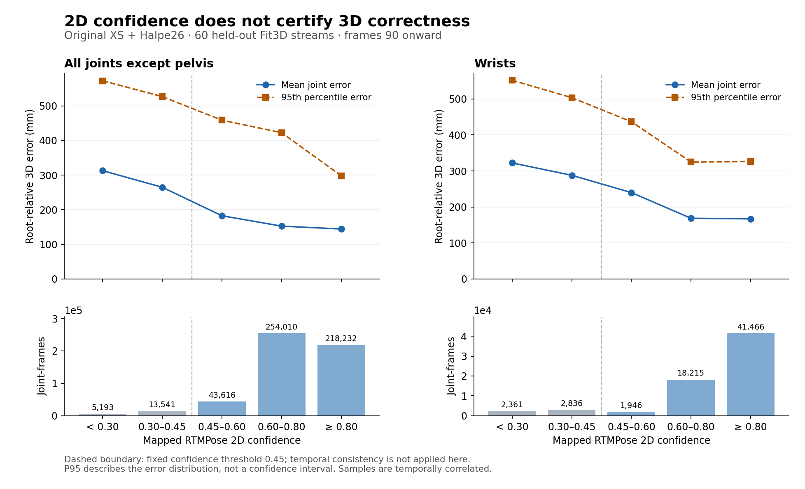

# RTMPose 신뢰도와 XS 3D 오차

2026-10-21. **신뢰도 점수는 도움이 되지만, 점수가 높다는 사실만으로
3D 관절 위치가 정확하다고 확정할 수 없다.** 따라서 현재 관측을 우선하는
원칙과, 그 관측이 실제로 믿을 만한지 확인하는 절차가 모두 필요하다.

이 결과는 기존 원본 MotionAGFormer-XS + Halpe26 경로의 완료된 Fit3D
검증 자료를 분석한 것이다. C1/C2 모델의 정확도나 iPhone 성능 결과가 아니다.
새 학습, 모델 실행, 임계값 탐색은 하지 않았다.

## 확인한 사실

별도 검증 대상 5명 × 3개 운동 × 4개 카메라, 총 60개 스트림의
90번째 출력 이후를 사용했다. 골반 기준 오차에서 골반 자체는 항상 0이므로
전체 표의 분모에서는 제외했다. 총 534,592개 관절·프레임, 양손목은
66,824개 관절·프레임이다. 동일인의 연속 프레임이므로 각각 독립 표본은 아니다.

| 2D 신뢰도 점수 | 골반 제외 평균 3D 오차 | 손목 평균 3D 오차 | 손목 관절·프레임 수 |
|---|---:|---:|---:|
| 0.30 미만 | 312.8 mm | 322.4 mm | 2,361 |
| 0.30 이상, 0.45 미만 | 264.9 mm | 287.9 mm | 2,836 |
| 0.45 이상, 0.60 미만 | 182.5 mm | 240.0 mm | 1,946 |
| 0.60 이상, 0.80 미만 | 152.6 mm | 168.5 mm | 18,215 |
| 0.80 이상 | 144.2 mm | 167.0 mm | 41,466 |

낮은 점수 구간의 오차가 더 크다. 그러나 점수 0.80 이상인 손목에서도
평균 오차는 167.0 mm, 95백분위 오차는 326.1 mm다. 이 구간의
11,202 / 41,466 = **27.0%**가 200 mm를 넘었다. 200 mm는 분포를
설명하기 위한 값이며 임상적 판정 기준이나 새 합격 기준이 아니다.

기존 신뢰도 경계 0.45 이상을 합치면 손목 평균 오차는 169.7 mm다.
이 집계에는 새 추정기의 시간적 일관성 검사를 적용하지 않았다.
원본 모델의 체계적 오차까지 신뢰도 하나로 판별할 수 있는지를 확인하는 분석이다.

현재 SimCC decoder의 점수는 두 좌표축 최댓값 중 작은 값이다.
해당 점수는 ‘정답일 확률’로 보정된 값이 아니다. 실제로 이번 분석의
골반 제외 관절·프레임 중 1,803개는 점수가 0–1 범위 밖이었다.
따라서 `0.8`을 ‘3D 관절이 맞을 확률 80%’로 해석해서는 안 된다.

## 구현과 해석

실험 G/H는 현재 2D 점수, 유한한 좌표, 과거 궤적과 인접 관절의
일관성 검사를 통과한 관절에서 원본 XS 좌표를 그대로 사용한다.
불확실한 구간에서는 예측과 제약을 사용하며, 예측한 관절은 확정적인
자세 평가에서 보류한다. 이는 관측을 보존하는 동작을 보장할 뿐,
XS의 3D 위치가 정답이라는 보장은 아니다.

카메라가 직접 관측하는 것은 2D이고, 깊이와 3D 골격은 XS가 추론한다.
높은 2D 점수에서도 깊이, 관절 정의, 학습 환경 차이 등에 따른
3D 오차가 남을 수 있다. 이 분석만으로 그 원인별 기여를 분리하지는 못한다.
또한 Fit3D 환경에서의 관계를 일반 사용자 환경의 신뢰도 보정으로
그대로 사용해서는 안 된다.

전체 보정 성능과 채택 판단은 [주 실험 보고서](motion_contact.md)를 따른다.
높은 점수 관절을 잘 보존한다는 이유만으로 보정 후보를 채택하지 않는다.

## 재현과 검증

입력 원본은 Home의 완료된 `20261020-v1-clean96` 결과다. 원본
manifest/results 해시와 각 스트림의 관측·점수 계산용 GT 입력 해시를
검사했다. GT는 이 분석의 mm 오차 계산에만 사용했다.
이미지와 프레임별 배열은 반출하지 않았다.

- [집계 JSON 및 입력·코드 해시](motion_contact_artifacts/confidence/confidence_audit.json)
- [벡터 그림](motion_contact_artifacts/confidence/motion_contact_confidence.svg)
- [그림 재현 해시](motion_contact_artifacts/confidence/figure_manifest.json)
- 분석 코드: `scripts/motion_contact_confidence_audit.py` (`506c742`)
- 그림 코드: `scripts/motion_contact_confidence_report.py`

Mac으로 복사한 집계 JSON의 SHA256은 Home 원본과 같다:
`2cfce71a3c35b9f0ded427055514fa53199b78563529a5d441ade0990960b47d`.
손목 전체 평균 180.157684 mm는 주 실험의 원본 A 값과 일치한다.
골반 제외 평균 156.016400 mm에 `16/17`을 곱하면, 골반을 포함하는
주 실험의 전체 MPJPE 146.838965 mm와 일치한다.
