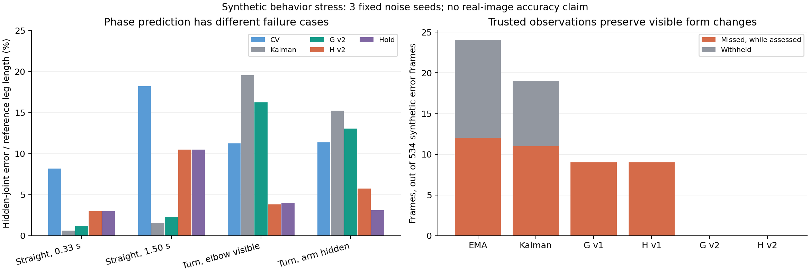

# Synthetic motion/contact behavior stress

2026-10-20. These results isolate estimator behavior after a simulated XS output.
They are **not** Fit3D accuracy, natural-occlusion performance, human-labelled PT
false negatives, or iPhone timing. Real keypoint/RGB inference experiments are
reported separately.

The user's observation-priority clarification is implemented in v2 G/H:
trusted observations pass through exactly, with velocity/covariance retained
for uncertain intervals. The v1 results remain unchanged. No thresholds were
selected from these scores. Source v1 is `40e5edc`, source v2 is `b29e7c9`.

## Final v3 regression rerun

The final candidate is v3 (`dd6c703`), which fixes two separately reproduced
evidence-validity bugs: untrusted legs inflating scale, and stale contact
candidates surviving long observation gaps. It retains v2's observation
priority and every numeric threshold. All 324 synthetic runs were repeated.

G/H v3 still preserve all 534 synthetic visible posture-error frames, with
zero missed or withheld frames in that test. The squat root-motion/hidden
ankle case improves from 4.10% leg-length error in v2 to 1.29% in v3 after
excluding the untrusted ankle from scale estimation. The straight-motion
phase failure and hidden support-change failure remain; the fixes do not
justify general adoption.

[V3 full aggregates and hashes](motion_contact_artifacts/v3/motion_contact_stress_summary.json)
and [v3 comparison figure](motion_contact_artifacts/v3/motion_contact_stress.png)
are separate artifacts. The tables and figure below intentionally retain the
original v1/v2 observation-priority comparison for traceability.



## Fixed experiment

Twelve cases, three fixed noise seeds (301–303), 210 frames at 30 Hz, nine
variants: 324 runs and 68,040 causal updates per version. No model inference
occurs in this experiment. The synthetic geometry is used only for scoring;
the estimator receives noisy positions, image observations/confidence,
exercise identity and fixed-camera evidence. Bone proportions come from its
own first 60 selected observations, activated at frame 81 with reliability 0.4.
There is no SMPL ground-truth profile or ground-truth phase input.

Cases cover constant wrist motion, short/long loss, reversal with a visible or
hidden elbow, stable support while the root moves, visible/hidden foot
relocation, a single confident wrong jump, and visible torso lean, knee
collapse and hip sag. This is a deliberately small engineering stress set.
Noise seeds are repeated perturbations of the same geometry, not independent
people or natural exercise samples.

Primary raw 3D noise is 0.3% of reference leg length per axis; image noise is
0.1%. The hidden observation is deliberately corrupted by a large offset.
This makes the experiment useful for catching logic failures but does not
represent a measured real-world occlusion distribution. Errors below are
percentages of synthetic reference leg length, not millimetres.

## Preserving genuinely observed posture changes

Across the three visible posture-error cases and all three seeds, there are
534 frames beyond the fixed synthetic geometric error thresholds.

| Method | Missed while assessed | Withheld | Error frames assessed |
|---|---:|---:|---:|
| A raw | 0 | 0 | 534 |
| B smoothing | 12 | 12 | 522 |
| D Kalman | 11 | 8 | 526 |
| G v1 | 9 | 0 | 534 |
| H v1 | 9 | 0 | 534 |
| G v2 | 0 | 0 | 534 |
| H v2 | 0 | 0 | 534 |

G/H v2 preserve the current noisy observation, including its genuine posture
change, instead of introducing smoothing delay. This does not prove that a
wrong high-confidence 3D inference can always be identified. Existing
downstream anatomical constraints are outside this isolated test and require
their separate final-pose assessment.

## Prediction and phase: conditional gains and failures

Mean hidden-joint error over the three seeds:

| Case | CV | D Kalman | G v2 | H v2 | Hold |
|---|---:|---:|---:|---:|---:|
| Straight wrist motion, 0.33 s hidden | 8.19% | 0.63% | 1.20% | 2.99% | 2.98% |
| Straight wrist motion, 1.50 s hidden | 18.24% | 1.60% | 2.29% | 10.49% | 10.48% |
| Reversal, elbow visible, 1.00 s hidden | 11.24% | 19.57% | 16.26% | 3.83% | 4.02% |
| Reversal, arm hidden, 1.00 s hidden | 11.36% | 15.22% | 13.05% | 5.75% | 3.12% |

H helps the visible-neighbor reversal case, but degrades straight movement.
Its phase heuristic is therefore **not a generally successful addition**.
Noisy finite-difference CV can be worse than holding. Constant-velocity
kinematics alone do not guarantee useful wrist prediction.

The low average Kalman error in the deliberately straight long-gap case is
not evidence of reliable long occlusions in real exercise. The algorithm
marks predicted joints invalid for definitive PT assessment and uncertainty
grows. The reversal cases demonstrate how the same extrapolation can fail.

## Contact and relocation

For a visible synthetic foot reposition, F/G/H release the old support after
0.20 s and reacquire 0.10 s after the movement ends, in all three seeds.
G/H v2 do not suppress the visible movement, whereas v1 G/H suppress more
than half the true displacement in 10% of the eligible five-frame windows.
These are three seeded executions of one relocation event, not a measured
natural-event detection rate.

When repositioning occurs entirely behind an occlusion, G/H cannot observe
the move. The old anchor expires instead of producing a verified MOVING
event; a new anchor is established about 0.30 s after visibility returns.
During the hidden movement, 65% of eligible movement windows are suppressed
by the predicted trajectory. Those predicted joints are withheld from PT
assessment. **Hidden support changes are not solved.** Reporting only
post-recovery stability would conceal this failure.

With the root moving while support remains fixed, G v2 hidden-joint error is
0.73% for the push-up wrist case and 4.10% for the squat ankle case. The
ankle case is worse than D (2.70%) or hold (1.39%). Contact is not uniformly
better than a temporal baseline. No root-relative ankle or contact depth is
fixed.

In the injected single confident jump, the raw wrist error is 103.34% of
leg length, versus 0.50% for G v2 and 0.49% for H v2. Both reject that frame
for assessment. This is one engineered gross-jump case; smaller plausible
mistakes and repeated confident mistakes remain important failure cases.

## Reproduction and artifacts

The full results remain under
`~/bpt-runs/motion-contact/20261020-synthetic-stress-{v1,v2,v3}`.
[Aggregate metrics and source/result hashes](motion_contact_artifacts/motion_contact_stress_summary.json)
include all variants, case means and seed ranges. The
[SVG figure](motion_contact_artifacts/motion_contact_stress.svg) is exportable.

```sh
python scripts/motion_contact_stress.py --out <new-output-directory>
python scripts/motion_contact_stress_report.py \
  --v1 <immutable-v1-directory> --v2 <immutable-v2-directory> \
  --out docs/results/motion_contact_artifacts
# Final candidate comparison; preserve the earlier v1/v2 report.
python scripts/motion_contact_stress_report.py \
  --v1 <immutable-v1-directory> --candidate <immutable-v3-directory> \
  --candidate-label v3 --out docs/results/motion_contact_artifacts/v3
```

Use the recorded source revision to reproduce each version. The first command
refuses to overwrite an existing run. Reporting requires an existing
environment with NumPy and Matplotlib. No parameters or model weights are
changed by the reporting script.
